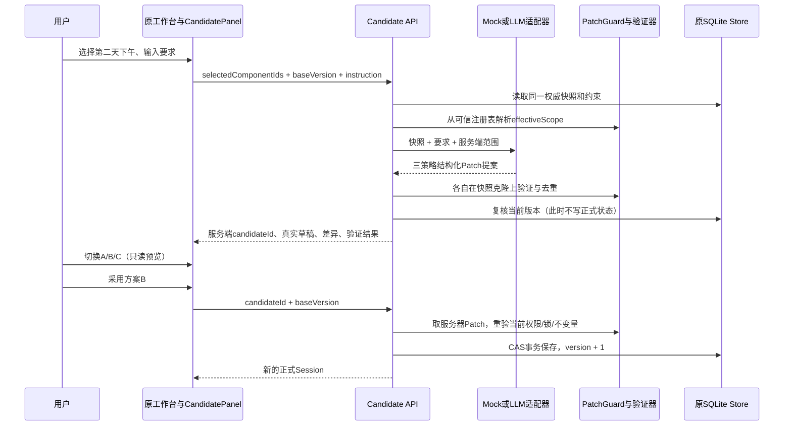

> Phase4增量：不改原主页面与提交边界；声明式只读Catalog、生成进度SSE、规则评分/排序及观测见[协议说明](protocol-integration.md)。以下历史章节按当时阶段保留。

> 当前版本0.6.4已解除固定第二天下午、只支持描述/时间、不可跨时段的演示限制，支持按选区编辑所有日期/时段及真实目录景点替换。标题、时段和组件归属由服务端派生同步，模型不能直接写这些元数据。以下Phase 1–3实现按当时阶段记述；当前增量规则与实测见 [范围扩展记录](edit-scope-upgrade.md)。

# Phase 0–3 架构说明

当前副本版本 `0.6.4-scoped-editor`。第12节描述用户授权的编辑范围扩展；前面各阶段实现说明按其边界保留。第1–6节记录复用的Phase 2候选链路，第7节及以后记录本轮Phase 3持久历史与明确恢复。审计见 [implementation-audit.md](implementation-audit.md)，实际运行结果见 [phase2-acceptance.md](phase2-acceptance.md)。沿用React/TypeScript/Vite、FastAPI/Pydantic/jsonschema、SQLite和pnpm；没有框架、路由或数据库迁移。

## 1. 状态与可信边界

- **正式业务状态**：SQLite Session中的既有 `tripState`。`TripDocument`由服务端稳定ID适配投影，仍只有一个业务事实源。
- **组件与呈现**：既有 `uiSpec` 和受信任组件注册表。UUID5绑定会话与既有实体ID，不用当前数组位置授权。
- **临时前端状态**：编辑模式、hover、selectedComponentId、自然语言草稿、候选列表及当前候选，均不等于正式状态。
- **持久约束**：服务端 `persistedConstraints`，包含组件锁与已启用硬约束。锁定操作通过原版本化接口保存。
- **候选**：原 `Store.proposals` 中带 `kind=phase2_candidate` 的服务器内存对象，包含归属、baseVersion、selectedComponentIds、字段子集、Patch、策略、模式、验证结果和过期时间。默认600秒，缓存上限500条，与旧预览共用容量；重启失效。

`candidateId`、合法性结论、标签、解释和实际差异均由服务器写入。Agent输出仅允许 `strategy` 和 `patch`，不接受其自评合法性、分数、权限、版本或代码字段。客户端Zod验证用于阻止异常结果渲染，不能授予写权限。

## 2. 请求到正式写入

调用模型时释放Store锁。生成前、生成后检查权威版本；请求期间行程变化返回409。所有候选都在同一个冻结快照上验证，不能把前一个候选的结果作为后一个候选的基础。

正式提交只接受 `candidateId` 和 `baseVersion`；extra字段禁止，不能夹带客户端Patch、allowedPaths或lockedIds。提交时检查归属、TTL和版本，重新解析范围并重放服务器保存的Patch。使用原 `commit`、SQLite `BEGIN IMMEDIATE` 与条件UPDATE，版本严格+1；失败事务不留部分写入。成功后清除此会话的其他候选。

## 3. 模块与接口

| 模块 | 责任 |
| --- | --- |
| `backend/trip_document.py` | Phase 1稳定ID投影、注册表、约束适配和锁保护 |
| `backend/patch_guard.py` | 原受限replace守卫、Schema、不变量、叶级Diff及全量原业务Diff |
| `backend/candidate_agent.py` | 统一generate接口、确定性Mock、真实LLM HTTP适配及严格模型输出合同 |
| `backend/candidate_api.py` | 服务器审核、实质差异筛选、候选缓存、TTL与正式提交 |
| `backend/access.py` | 复用访客归属、同源检查、限流和并发；候选生成纳入generation |
| `src/features/agentic-editor/CandidatePanel.tsx` | 自然语言、模式/字段选择、候选切换、差异、只读预览及确认采用 |
| `src/features/agentic-editor/candidateSchema.ts` | Zod与客户端真实Diff/补丁/差异条目交叉验证 |
| `src/components/StopCardContent.tsx` | 从原卡片最小抽出的共享呈现，正式卡片和只读候选共同使用 |
| `src/api.ts`、`src/App.tsx` | 沿用原请求错误处理、busy保护与commitSession；主行程不被候选替换 |

| 接口 | 合同 |
| --- | --- |
| `GET /api/edits/status` | 默认候选模式、LLM配置状态、模型公开标识、TTL和超时，不返回密钥 |
| `POST /api/sessions/{id}/edits/candidates` | `{baseVersion, selectedComponentIds, instruction, agentMode?, fields?}` |
| `POST /api/sessions/{id}/edits/commit` | `{baseVersion, candidateId}` → 原Session响应，version+1 |

继续采用 `/api/sessions/{id}/...`，使既有会话归属中间件生效；没有为形式统一改动全站路由。Phase 1的 `/editor/scope`、`/locks`、`/preview`、`/apply` 与既有地图、直接编辑、历史接口保留。

生成响应包含 `requestId`、`baseVersion`、`generationMode`、`requestedCount=3`、`candidateCount`、`effectiveScope`、`candidates`、`rejectedCandidates` 和 `diagnostics`。每个候选有服务器ID、策略、Patch、真实TripDocument草稿、changedPaths、前后值differences、validationReport和expiresAt。

## 4. 权限与候选审核

权限沿用Phase 1：当前单选组件及其注册子组件中，只允许 **第二天下午活动description/startTime**。可由用户缩小字段子集，不能扩大白名单。锁定的日、时段、活动及其子对象排除；没有选区默认无权限。

审核顺序：

1. 模型结果严格JSON解析（拒重复键、非有限数、截断输出），候选JSON Schema/Pydantic严格校验；候选错误独立记录。
2. PatchGuard限制16个replace、16KB，精确解码后路径段匹配；拒根/父覆盖、前缀碰撞、危险属性、特殊Pointer、内部元数据和额外操作键。
3. 在克隆上应用，验证TripDocument Schema、固定时段、严格递增时间、持久硬约束和锁定对象不变。
4. 对真实TripDocument叶Diff和完整原业务数据Diff核对权限；只回投获准字段。描述修改保留路线，时间修改按原依赖策略清除受影响日的派生路线缓存，其他日期保持。
5. 比较候选最终状态；相同或全部可编辑活动时点差异不超过5分钟的候选保守去重，避免只换描述文案冒充不同方案。仅保留每种策略一个合格候选，不足3个给出原因，全部失败不缓存可提交候选。

验证结果全部来自服务器，UI显示实际通过项和字段变化数。没有编造语义符合度、真实交通节省或LLM自评分数；Phase 4评分/优化不在本轮。

## 5. 两种适配器

**Mock**明确为规则演示，针对轻松、休息、节奏等受支持意图读取真实当前活动与时间。A保持时间、修改最少描述；B在原顺序内调整合法时点；C使用不同的时点和休息提示。时间空间、字段子集或锁不足时返回合格子集或明确报错。未经交通查询，不将效率策略表述为已证实缩短路程。

**LLM**使用服务端配置的 `LLM_BASE_URL + /chat/completions`，Bearer密钥、模型ID、超时和输出上限沿用现有配置。要求JSON结构化输出，输入包含当前文档、权威版本、选区与已计算范围。模型输出仍全部视作不可信提案；无Key、认证失败、超时、非法JSON、越权、不变量冲突均明确提示，不降级伪装Mock。

`CANDIDATE_AGENT_MODE=mock|llm`控制默认，网页可显式切换；`CANDIDATE_TTL_SECONDS`默认600、配置范围30..3600。原 `AGENT_MODE=demo|llm`用于原城市规划，两者独立。Key只在服务端，示例见[环境配置](../.env.example)。

## 6. 预览隔离与原页面

CandidatePanel持有候选临时状态；主左栏继续渲染原Session，不向正式TripDocument应用候选。候选只将经过验证的草稿活动映射到原TripStop数据绑定，复用StopCardContent与原卡片/时间轴CSS。只读模式不渲染编辑输入、外链、地图图片或查询动作，没有Effect或保存回调。

切换候选与取消只改变面板临时状态，不调用commit、不保存本地草稿，不改锁与地图数据。选区、正式版本、字段、模式或用户要求变化会丢弃旧候选；请求代次与AbortController阻止迟到结果重新出现。候选到期有前端提示，服务器TTL仍是最终判断。

没有创建新旅游页面、路由、图标或地图引擎，没有执行旧GeneratedSurface。原地图与备选、导航、图片/插画、导出、输入、独立滚动保留。真实服务联调与容器部署不是本轮验收依据。

## 7. 阶段边界

Phase 2的独立预览和服务端提交继续保留。当前仅实施至Phase 3；没有Phase 4的A2UI/AG-UI/SSE、Pareto或评价实验。LLM HTTP链路、Mock链路与真实服务商联调在报告中分开记录。

## 8. Phase 3持久版本与事务

`backend/versioning.py`通过白名单构造不含私有身份或服务器配置的快照，`backend/persistence.py`在原SQLite库增加`trip_versions(trip_id, version, record)`表，不替换数据库，也不重写已有sessions结构。原正式会话的CAS更新与不可变版本记录INSERT在同一个`BEGIN IMMEDIATE`事务内完成。若版本冲突、记录失败或约束验证失败，当前状态和历史同时保持原样。

每次创建和正式修改保留tripId、version、parentVersion、baseVersion、createdAt、userRequest、selectedComponentIds、candidateId、patch、allowedPaths、changedPaths、验证报告、TripDocument快照、原业务/展示完整payloadSnapshot和constraintsSnapshot。候选采用沿用服务器保存的候选来源，不让手动操作继承上一个候选的ID/Patch。呈现和约束操作记录明确的用户操作，不伪造模型候选。

`payloadSnapshot`涵盖tripState、uiSpec、controlState、routeData、目录和规划参数、稳定ID/时段元数据、persistedConstraints、presentationSettings；不包含_owner、API密钥或不断嵌套的_undo。约束快照为persistedConstraints，旧生成/酒店锁同时保存在payloadSnapshot.controlState，恢复时一并恢复。

为兼容此前仅有摘要的旧库，首次读取历史或新提交只为当前已知版本建立checkpoint，明确标记没有重放历史校验；不会捏造已丢失的过去版本快照。原_undo兼容保留并标记旧快照来源。

## 9. 授权命名空间与约束

Phase 2自然语言候选继续只授权第二天下午description/startTime的TripDocument叶路径；没有扩大模型权限。Phase 3加入三个独立可信操作：

- `/editor/display`：必须明确选整日DayCard，允许该日`uiSpec.regions[region].view/compact`，单卡或时段选区不自动获得整日权限，现有锁继续检查。
- `/editor/global-presentation`：必须`confirmGlobal=true`，只改`presentationSettings.showBudgetDetails`。UI单独说明全局范围并勾选授权，预算业务值不因此改变。
- `/editor/constraints`：必须`confirmConstraintChange=true`，设置/移除max_budget硬约束；UI单独确认，普通编辑不能移除已有约束。max_budget限制预算输入上限，不等于控制真实费用或消费总额。

普通commit验证persistedConstraints不变、controlState不变，受锁业务/共享展示不变，再执行时间严格递增、预算硬上限等不变量。时间顺序约束不能由普通编辑解除。锁操作也不能夹带硬约束变更。恢复、撤销、重置是明示的全快照控制行为，按下节语义处理。

`pathNamespaces`明确区分：候选/手工Patch使用TripDocument路径；可信展示和全快照操作使用payloadSnapshot路径。每条版本同时记录documentChangedPaths与payloadChangedPaths，避免把缩略投影当成完整持久状态。版本变化本身不计入业务Diff。

## 10. 历史、Diff与恢复

| 接口（接在 `/api/sessions/{id}` 后） | 用途 |
| --- | --- |
| `GET /versions` | 当前版本与持久版本摘要，不返回完整快照 |
| `GET /versions/{version}` | 归属检查后的版本完整记录 |
| `GET /versions/{version}/diff?againstVersion=N` | 两个已保存payload快照的真实字段前后值 |
| `POST /versions/restore` | `{baseVersion,targetVersion,confirmRestore:true}`，完整恢复并创建新版本 |
| `POST /editor/display` | 明确整日选区的卡片/时间轴与compact枚举操作 |
| `POST /editor/global-presentation` | 明确全局预算展示授权 |
| `POST /editor/constraints` | 明确预算硬约束变更 |

恢复确认明确写出：将行程、展示、组件锁和硬约束同步恢复到目标快照，可能解除当前锁或恢复旧锁，并创建当前版本+1。targetVersion只作来源，不回退版本指针，不删除审计链；记录restoreFromVersion。数据先按目标约束验证，再原子提交。撤销沿用原栈，增加_undoVersionIds以定位持久快照，创建新版本并说明同步恢复约束。重置同样恢复初始快照约束，不把当前硬预算错误保留到初始预算上。

`VersionHistory.tsx`读取服务器版本列表、查看真实Diff、显示锁和预算约束、要求恢复确认。`GlobalControls.tsx`将全局呈现与约束变更从局部编辑分离；选区/当前版本变化会废弃旧确认。409提示带候选baseVersion与服务器currentVersion，前端同时显示当前选区，失败不应用候选，允许同步最新状态后重新生成。

## 11. 多轮与视觉测试边界

`tests/phase3-ui.cjs`自管8014和独立UUID测试库，使用无Key的demo/mock。同一tripId连续10次合法编辑，另用其他客户端一次合法写入形成UI冲突；记录各轮版本、授权路径、实际TripDocument/原业务Diff和约束。刷新与真正停止/启动服务后，正式状态、版本记录与约束相等，未提交候选按原规则失效。

直接未授权持久化差异和间接布局变化分别记录。稳定1600×1100、DPR1视口裁剪第一/三天首卡及酒店作像素比较，并测量第二天页面中酒店、预算、整日面板几何。所选裁剪没有动态时钟、地图瓦片或远程图片，因此没有掩膜掉待验证内容。局部卡片高度/文本换行可能移动后面的未选酒店，这种真实间接漂移会单独报告，不能用数据Diff为零或小区域像素相同宣称整页完全不变。

最终结果与失败记录见[Phase 3验收](phase3-acceptance.md)、[多轮报告](multiround-test-report.md)。本轮未接入Phase 4协议、流式正式写入或新的评分/优化机制。

## 12. 解除Phase 1演示限制（0.6.4）

当前可信组件注册表对所有已有日期、上午/下午/晚上、景点卡片计算选区，不再写死day2/pm。授权字段为description、startTime、placeId；默认前两项，更换真实景点须用户明确勾选或点击地点授权示例。原生整日样式、全局展示/预算约束入口继续独立工作，模型不能用局部Patch修改全局或约束。

placeId仅来自当前会话真实地点目录，同日重复或虚构地点拒绝。景点名称和没有显式覆盖的目录默认描述，由服务器从该placeId派生。开始时间允许跨时段，服务器只更新该获准活动的period、ActivityCard.parentId及对应activityPeriods元数据，ID不变；不能移入已锁时段，也不能借移动逃离原锁或违反时间顺序。

Patch本身仍只写三种直接字段，title/period/parentId不能直接由模型写。服务端返回derivedChangedPaths，审核器从授权直接Patch和可信目录重建完整草稿，复核原业务全量Diff与目标锁。前端额外使用正式Session、旧stop是否有description以及会话目录做相同的精确重放，核对真实changedPaths、派生字段及每条differences，禁止把响应自报派生路径当作新权限。持久版本审计把直接allowedPaths与derivedChangedPaths分开记录，旧版本不改写。

Mock移除第一/三天词语黑名单，按实际选区日期和活动时段生成三策略；明确换景点时从真实目录提供不同地点候选，去重同时检查地点与时间。显式HH:mm按获准时间提出提案；没有足够合法差异时仍说明数量不足。LLM沿用同一安全边界及服务端配置，禁止运行模型源码的约束不变。

测试与新能力演示见[范围扩展记录](edit-scope-upgrade.md)。这次没有接入Phase 4协议或评分框架；单次单选组件、受控Patch语法、锁与版本/CAS保护继续存在。
